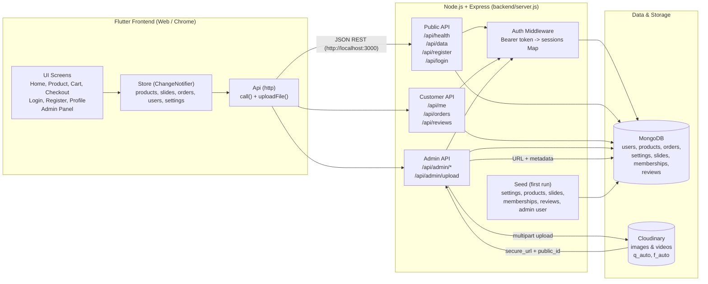
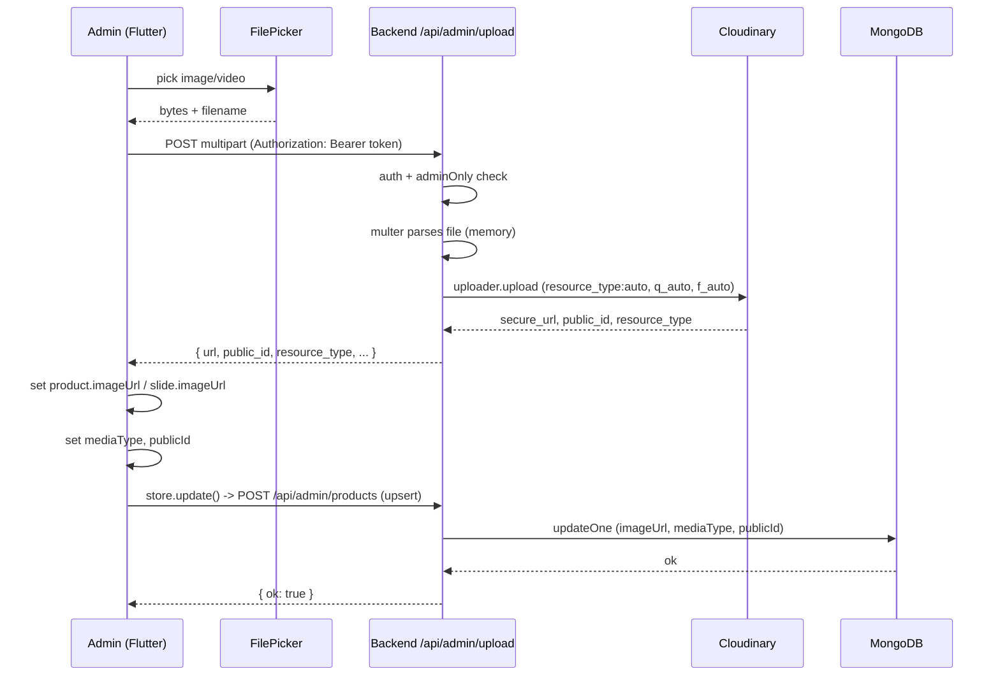
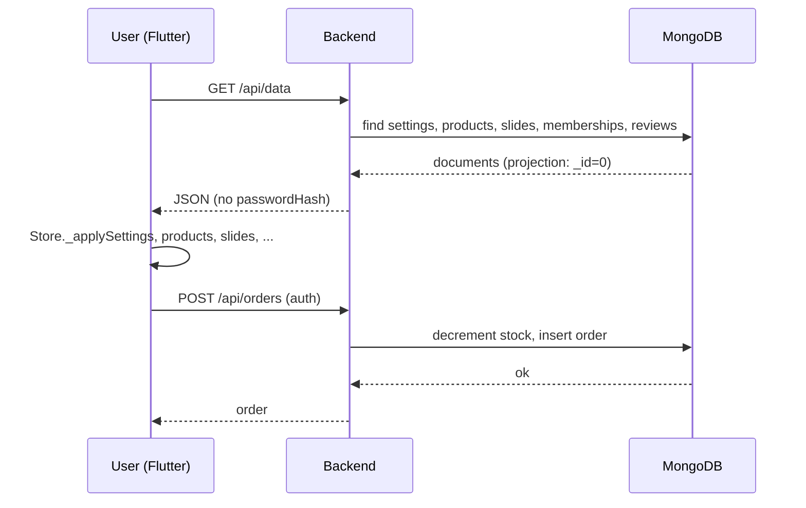
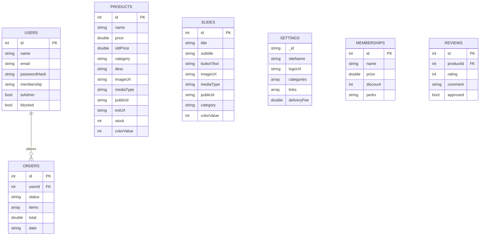
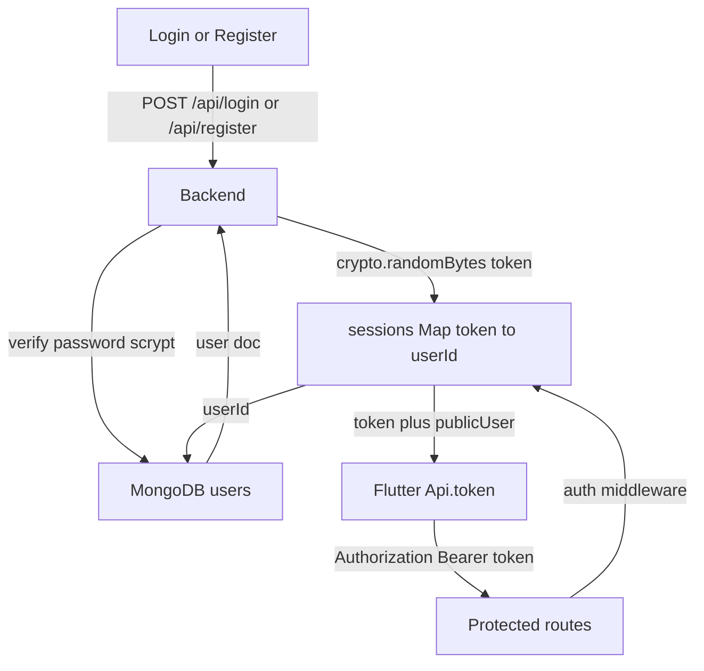

# MyShop — System Blueprint (Frontend + Backend)

## 1. High-Level Architecture



## 2. Request Flow (Admin Media Upload)



## 3. Data Flow (Normal User)



## 4. Data Model (MongoDB Collections)



## 5. Auth Flow



## 6. Tech Stack

| Layer | Technology |
|-------|-----------|
| Frontend | Flutter (Dart) — Web, Chrome |
| HTTP client | package:http |
| File picker | package:file_picker |
| Backend | Node.js + Express |
| Database | MongoDB (mongodb driver) |
| Media storage | Cloudinary (cloudinary v2 + multer) |
| Auth | Token-based (in-memory sessions, crypto) |
| Deployment | Vercel (frontend SPA), backend separate |

## 7. Folder Structure

```
E-commerce-3/
├── backend/
│   ├── server.js          # Express API + MongoDB + Cloudinary upload
│   ├── package.json
│   └── node_modules/
├── frontend/
│   ├── lib/main.dart      # Flutter app (UI + Store + Api + Models)
│   ├── pubspec.yaml
│   └── build/web/         # flutter build web output
├── vercel.json            # SPA routing rewrites
└── (no root server.js / main.dart - moved into folders)
```

## 8. API Endpoints Summary

**Public:** `GET /api/health`, `GET /api/data`, `POST /api/register`, `POST /api/login`

**Customer (auth):** `PUT /api/me`, `POST /api/me/membership`, `GET /api/my/orders`, `POST /api/orders`, `POST /api/orders/:id/return`, `POST /api/reviews`

**Admin (auth + adminOnly):** `GET /api/admin/data`, `PUT /api/admin/settings`, `POST /api/admin/:col/upsert`, `POST /api/admin/:col/delete`, `POST /api/admin/upload`
```
